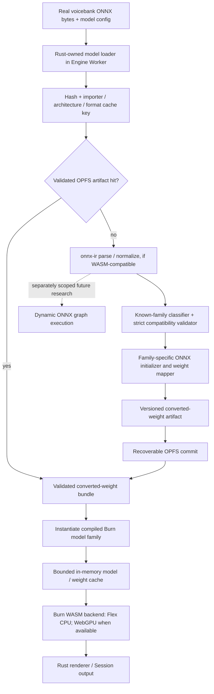

# Runtime ONNX Import into Burn/WASM — Engine Investigation Plan

**Status:** **Awaiting Final User Approval** — planning/source inspection only. No importer implementation, model conversion/inference, dependency changes, builds/tests, branches/worktrees, Taskboard writes, frozen contract changes, or merges are authorized.

## Product objective and scope

Allow users to load supported ONNX models directly from real voicebanks at runtime, validate and import their weights into a Burn-based inference path, cache the converted representation, and run inference in WASM **without rebuilding the application for every compatible voicebank**.

This plan is deliberately **model-driven, not general-purpose ONNX compliance**. Its first product target is a known-family runtime importer: architectures are compiled into the engine once; a compatible voicebank supplies model metadata and weights at runtime. Unsupported models must produce explicit diagnostics and may use the existing native/server renderer. Do not imply arbitrary ONNX execution.

**Model priority:** (1) Worldline R2 and DiffSinger vocoders; (2) neural phonemizer/G2P models actually loaded by supported paths; (3) DiffSinger acoustic, pitch, variance, duration, linguistic, and other neural stages; (4) broader ONNX support only when actual product requirements justify it. Full DiffSinger execution in WASM is long-term, not an E1 prerequisite. Dictionary/rule phonemizers must not be forced through ONNX.

The UI Worker-first plan remains an independent workstream and is not changed by this revision. Engine inference stays Rust-authoritative; React/Dockview/PixiJS do not own neural inference or synthesis. Preserve the frozen Project Session contract. Any required public API/capability change is a separate proposal and review.

## Evidence labels and authorization boundary

- **Source-verified:** current repository or upstream source/docs were inspected; no execution implied.
- **Historical runtime-verified:** an earlier POC/task reports a run; it was not repeated here and does not prove Burn import.
- **Planned/unverified:** requires separately approved implementation, model conversion, build, or inference work.
- Static inventory and architecture planning are permitted now. E1–E4 experiments and every dependency/code/Taskboard/branch change require separate authorization.
- Preserve the existing ONNX-on-WASM limitation until individual model families pass approved acceptance gates. Do not update capability claims or the frozen Project Session contract in this plan.

## Source baseline and model inventory to complete

### Current product paths

- **Source-verified:** [`engine-wasm/Cargo.toml`](../../native/crates/engine-wasm/Cargo.toml#L10-L39) excludes ONNX Runtime and Burn from the current WASM product engine. [`known-limitations.md`](../architecture/known-limitations.md#L16-L51) records this as an intentional limit; the existing ORT-Web POCs are JavaScript inference, not the Rust-authoritative product path.
- **Source-verified:** native DiffSinger uses `ort = 2.0.0-rc.13` ([`Cargo.toml`](../../native/crates/diffsinger/Cargo.toml#L6-L17)). Its code path includes acoustic ONNX (tokens/durations/f0 → mel), vocoder ONNX (mel/f0 → PCM), and an optional duration ONNX path ([`model.rs`](../../native/crates/diffsinger/src/model.rs#L1-L20), [`dsdur.rs`](../../native/crates/diffsinger/src/dsdur.rs)). Real Kiritan/golden-bank fixtures exist, including [`acoustic.onnx`](../../test/golden/diffsinger-kiritan/acoustic.onnx) and [`vocoder model.onnx`](../../test/golden/diffsinger-kiritan/nsf_hifigan/model.onnx); the `diffsinger-fake` fixture is not valid evidence for real-model compatibility.
- **Source-verified:** the current project uses Burn **0.21**. The existing [`moe-wasm` engine](../../native/crates/moe-wasm/src/engine.rs#L7-L47) runs a custom `ContextAcoustic` model/checkpoint, not an ONNX-imported model; its WASM backend currently uses NdArray ([`Cargo.toml`](../../native/crates/moe-wasm/Cargo.toml#L10-L20)). This is backend precedent only.
- **Source-verified, limited:** a static scan of the Rust phonemizer crate found no ONNX/ORT dependency or neural ONNX load path; its current G2P path is dictionary/rule-based ([`phonemizer Cargo.toml`](../../native/crates/phonemizer/Cargo.toml), [`g2p.rs`](../../native/crates/phonemizer/src/g2p.rs)). This does not prove that no other supported host or external phonemizer loads neural models; E0 must trace the actual loader paths before adding G2P models to product scope.
- **Historical runtime-verified, narrow scope:** the R2 browser POC used deterministic synthetic WORLD-like features, not real audio-derived features. It records `f0[1,T]`, `sp_env/ap[1,T,1025] → mel[1,T,128] → waveform[1,T*512]`; the 85,404-byte [R2 mel model](../../models/r2/mel.onnx) is opset 20 / 304 nodes and calls out STFT/If/Resize. The [PC-NSF-HiFiGAN vocoder](../../models/r2/pc-nsf-hifigan/pc_nsf_hifigan_44.1k_hop512_128bin_2025.02.onnx) is 56,616,643 bytes, opset 15 / 272 nodes, with dynamic frame/sample lengths ([`r2-wasm-poc.md`](r2-wasm-poc.md#L58-L95)). Its parity is ORT-Web vs native ORT, not Burn parity or product acceptance ([`r2-wasm-poc.md`](r2-wasm-poc.md#L104-L127)).

### E0 compatibility inventory requirements

Start with the actual [R2 PC-NSF-HiFiGAN model](../../models/r2/pc-nsf-hifigan/pc_nsf_hifigan_44.1k_hop512_128bin_2025.02.onnx), then actual DiffSinger vocoders loaded from supported voicebanks. Include neural phonemizer/G2P models only if a supported renderer/phonemizer path really loads them. Do not infer shared architecture from the word “vocoder.” The [R2 mel model](../../models/r2/mel.onnx) may be used as a small parser smoke fixture, but is **not** a blocking prerequisite for vocoder-first inference.

| Family / candidate | Evidence now | E0 must establish |
|---|---|---|
| R2 PC-NSF-HiFiGAN vocoder | POC reports dynamic mel/f0 frame inputs and waveform output; Conv, LeakyRelu, ConvTranspose, Slice, Pad, CumSum, and other operators. | Actual graph operators/configurations, input/output names, rank/dtype/axes, symbolic dimensions, initializer layouts, padding/trim/hop behavior, memory, and whether runtime weights match a compiled Burn family. |
| DiffSinger vocoders | Native `diffsinger` loads a vocoder ONNX; real Kiritan and golden-bank fixtures exist. | Inventory each actual supported model/config, operator/shape/dtype/weight layout, preprocessing/postprocessing, and any external weight data. Determine whether any are genuinely compatible with R2’s architecture by graph and weight evidence. |
| Neural phonemizer/G2P | No ONNX loader was found in the current Rust `phonemizer` crate; rule/dictionary G2P is separate. | Trace every supported native/server/voicebank path, identify real models and required outputs/timing if any, or explicitly record that there is no current ONNX product target. Do not include reference-tree assets on presence alone. |
| DiffSinger acoustic/duration/pitch/variance/linguistic stages | Acoustic and optional duration paths are present in native code; full real-model metadata is not yet inventoried. | List every stage/config actually used by supported voicebanks. This is later scope; it does not block E1. |
| [R2 mel model](../../models/r2/mel.onnx) | Small R2 graph with recorded POC metadata. | Optional parser/importer smoke only; it cannot qualify a vocoder or delay E1. |
| MoE acoustic checkpoint | Custom Burn architecture/checkpoint, not ONNX import. | Keep separate; determine whether any selected MoE path needs a compatible ONNX vocoder. |

For each in-scope model, E0 records provenance/license; content hash and file size; ONNX opset/domain/op counts and attributes; tensor names, dtypes, ranks and static/symbolic dimensions; initializer names/layouts/values; external-data references; model config; preprocessing/postprocessing; expected waveform frame count/sample rate; and the active Rust loader/consumer path. Mark production voicebank models separately from test, golden, reference-only, and fake fixtures.

## Runtime-import architecture

OPFS is a storage service for derived model artifacts; it does not create a second project/session authority. A Worker-side host adapter may read voicebank bytes and persist cache artifacts, while model validation, weight conversion, Burn instantiation, and inference remain in the Rust Engine. Cache hits and misses must both be visible in diagnostics. The diagram is a proposal, not evidence that the runtime importer or cache exists.

### Path A — Known-family runtime import (initial product target)

A supported architecture implementation is already compiled into the engine. At runtime: parse/inspect the voicebank ONNX; identify its family; validate graph signature, supported operators/configurations, tensor dimensions/dtypes, and model config; map/transform the ONNX initializers into the exact parameter layout expected by that Burn implementation; instantiate/load the compatible model; and run it. A compatible voicebank must work with the same WASM build—no per-voicebank rebuild/code generation. Unknown or incompatible variants fail with actionable model/operator/shape diagnostics and can remain on native/server rendering.

This path is not arbitrary graph support. It requires a family-specific compatibility contract and tested weight mapping (names, transposes/layout, biases, quantization, constants, and model version). The converted artifact’s exact format is TBD; do not assume Burnpack is suitable for runtime-mapped weights.

### Path B — Dynamic graph execution (future, separate scope)

Parse an ONNX graph into a runtime execution plan and dispatch nodes through Burn tensor operations, including shape inference, dynamic dimensions, control flow, constants/initializers, allocation/liveness, operator semantics, and diagnostics. `onnx-ir` can be evaluated as a frontend, but parsing an IR does not execute it. This path has a much larger operator/shape/security/performance scope and is **not** an automatic capability of Path A or official `burn-onnx`.

Keep the boundary modular: an ONNX frontend/normalizer yields an inspected graph; an importer selects a known-family weight mapping or (only after separate approval) a future graph executor. This allows later upstream runtime graph support to replace the execution path without changing the UI or Session ownership model.

| | Path A: known-family import | Path B: dynamic graph execution |
|---|---|---|
| Initial role | Product target for supported vocoder families. | Future research only when actual supported models require it. |
| What is compiled into WASM | A finite set of Burn architecture implementations, compiled once. | A general runtime dispatcher/operator library; no new WASM build per model, but substantial additional engine capability. |
| Runtime voicebank work | Parse/validate graph metadata and convert weights into the selected compiled model. | Parse graph, construct runtime plan, execute its nodes and dynamic paths. |
| Compatibility | Strictly limited to validated model-family signatures/configurations. | Broader only as each runtime op/shape/control-flow case is implemented and tested; not universal by default. |
| Go/no-go | Reject nonmatching models; native/server fallback. | Separate proposal, resource/security review, and E0/E1 evidence required before any implementation. |

## Official Burn ecosystem reuse boundaries

The official [`tracel-ai/burn-onnx`](https://github.com/tracel-ai/burn-onnx) project remains the importer/reference path, not the only product path. Current official [Burn v0.22.0](https://github.com/tracel-ai/burn/releases/tag/v0.22.0) and [`burn-onnx` v0.22.0](https://github.com/tracel-ai/burn-onnx/releases/tag/v0.22.0) are ahead of this repository’s Burn **0.21**; `burn`, `burn-store`, `burn-onnx`, and `onnx-ir` version/API alignment must be checked before any dependency change.

- **`onnx-ir` candidate:** official upstream parsing/normalization and typed IR may be reusable for runtime inspection, operator metadata, shapes/dtypes, constants, and graph diagnostics ([upstream crate](https://github.com/tracel-ai/burn-onnx/tree/main/crates/onnx-ir), [`pipeline.rs`](https://github.com/tracel-ai/burn-onnx/blob/main/crates/onnx-ir/src/pipeline.rs)). Its public `parse_bytes` path copies model bytes; `parse_file`/mmap is a different path. The crate’s default `mmap` feature, filesystem/external-data behavior, edition/dependencies, peak memory, and actual WASM compilation/runtime compatibility must be evaluated. No WASM compatibility is proven here.
- **Official `burn-onnx`:** `ModelGen`/`onnx2burn` generates typed Burn Rust code and Burnpack weights ahead of time; it is not a dynamic graph executor. Keep it as a reference for model structures, ONNX semantics/operator support, normalization/rewrite behavior, weight layouts, and numerical comparison; it can also be a separately approved build-time fallback for selected models. Do not let code generation become the only product path or require a new WASM build for every compatible voicebank. See the [official README](https://github.com/tracel-ai/burn-onnx/blob/main/README.md), [ModelGen API](https://github.com/tracel-ai/burn-onnx/blob/main/crates/burn-onnx/src/import/model_gen.rs), and [Burn import guide](https://github.com/tracel-ai/burn/blob/main/burn-book/src/onnx-import.md). The [Burn WASM guide](https://github.com/tracel-ai/burn/blob/main/burn-book/src/advanced/web-assembly.md) and [official browser example](https://github.com/tracel-ai/burn-onnx/tree/main/examples/image-classification-web) are feasibility precedents for Flex/WebGPU only, not proof of synthesis-model inference.
- **Operator reference:** compare exact `(domain, op_type, opset, attributes, dtypes, optional inputs)` with the [official support matrix](https://github.com/tracel-ai/burn-onnx/blob/main/SUPPORTED-ONNX-OPS.md). Official `CustomOp`/`OpOverride` hooks help generated code, but are not a runtime operator registry or general graph executor; graph rewrites and subgraph restrictions still apply ([development guide](https://github.com/tracel-ai/burn-onnx/blob/main/DEVELOPMENT-GUIDE.md#custom-operators-and-overrides)). Reuse upstream semantics/validation/weight logic only where its API and license permit; identify the exact boundary instead of copying a parallel general importer.
- **Upstream evidence caveat:** official README/release material differs on 1,185 vs 1,190 passing ONNX backend nodes of 1,765. Neither figure establishes the required voicebank family, dynamic-shape, or WASM compatibility.

## OPFS and in-memory cache proposal

No converted-model cache is established by this plan. The existing [`ProjectStore`](../../web/app/project-store.js#L26-L40) shows OPFS is already used for browser project storage; the model cache is a separate, derived-artifact service. It must not replace the original voicebank model or claim arbitrary ONNX code has been compiled to WASM.

### Persistent OPFS cache

- Store a versioned manifest, validated architecture ID/version, importer/parser identity/version, converted-format version, source model content hash, compatibility signature (operators/configs, tensor names/shapes/dtypes), per-file checksums, and converted weights. The initial key is `(model content hash, importer version, architecture ID, converted-format version)`; include weight-mapper version when it can change the conversion result.
- Prefer backend-neutral converted weights; if an artifact is backend-specific, include backend/format identity in the key. The artifact format (Burnpack or another representation) is an E0/E1 decision, not assumed.
- On every load, verify manifest/schema, hashes/checksums, size bounds, supported architecture and format versions, and expected parameter names/shapes before instantiating. Corruption or mismatch becomes a cache miss plus a surfaced diagnostic, not unchecked model loading.
- Use a temporary/versioned entry, write and close all data, validate it, then publish a final commit manifest/marker. Since OPFS does not guarantee a multi-file transaction, startup recovery must detect incomplete entries and remove/quarantine them. Verify actual OPFS write/replace semantics before implementation.
- Invalidate on model-content change, parser/importer or normalizer version change, architecture/weight-mapping change, or converted-format schema change. Define cleanup/re-import; do not silently load stale weights.
- Handle quota exhaustion and browser eviction: request persistence only as a best effort, report cache unavailable, delete least-recently-used derived artifacts where safe, and retain the source voicebank model. Persistent cache loss must not corrupt the project.

### In-memory runtime cache

Bound the number/bytes of active Burn model instances and weight tensors; key by converted artifact plus device/backend where necessary. Use explicit active-session references and LRU eviction only when not in use. Release ONNX bytes, parsed IR, temporary converted tensors, and duplicate weight buffers as soon as the next validated stage owns what it needs. Avoid simultaneously retaining raw ONNX + copied parser bytes + full IR + converted weights + loaded Burn parameters unless measured memory requires it. Establish per-model peak-memory limits from E1 baselines; if a model cannot load within budget, report unsupported-on-this-device and use native/server fallback.

## Revised E0–E4 roadmap

Each gate is a future authorized work item; planning is not permission to run it. Record a model-by-model pass/conditional/no-go result. Do not make a later family a prerequisite for earlier validated vocoders.

### E0 — Model-driven compatibility inventory (source-only first)

1. Trace active Rust loaders and supported voicebanks. Start with R2 PC-NSF-HiFiGAN, real DiffSinger vocoders, then actual neural phonemizer/G2P models if loaded by a supported path. Inventory DiffSinger acoustic/duration/pitch/variance/linguistic and other ONNX stages separately.
2. Produce the graph/config/shape/dtype/initializer/pre-postprocessing matrix specified above. Record external-data layout, opset, operator attributes, symbolic dimensions, expected outputs, sample rates/hop sizes, provenance, license, and real voicebank fixtures.
3. Compare R2 and each DiffSinger vocoder by graph structure, operator signatures, tensor dimensions, weight names/layouts, configuration and outputs. Decide whether they genuinely share a reusable compiled Burn architecture; do not infer it from “vocoder.” Choose the first E1 target from evidence.
4. Check official `onnx-ir`/Burn APIs and version compatibility for `parse_bytes`, normalization, external data, optional mmap, build target, and memory. Decide what can be reused versus what requires a separate adapter. No dependency changes or conversions in E0.
5. Classify every model as supported-family candidate, needs a new compiled architecture, dynamic-graph-only candidate, reference/test-only, or not currently loaded. Identify model license/redistribution and security constraints.

**E0 exit:** audited model-to-loader map, per-family operator/shape/weight inventory, credible first vocoder target, architecture-sharing decision, importer/API/WASM risks, and explicit unsupported list. The [R2 mel model](../../models/r2/mel.onnx) may be an optional parser smoke; it does not block E1. If no known-family vocoder can be mapped, return a go/no-go and exact gap before considering Path B.

### E1 — Runtime vocoder ONNX import on WASM

Future POC: load a real `vocoder.onnx` from a supported voicebank at runtime; validate its architecture/configuration; map/convert the ONNX initializers into the compiled Burn vocoder; instantiate it in the existing Rust Engine/Worker; run the Burn WASM backend using reference mel/f0 tensors; return waveform output. **Do not rebuild WASM for each compatible voicebank.** First establish whether Path A suffices; if it does not, name the exact graph/operator/shape requirement that requires Path B.

Acceptance:

1. Use an actual supported voicebank vocoder selected by E0, not a fake or synthetic model. To demonstrate family support, test two distinct real model files sharing the validated architecture with the same WASM build where such fixtures are available; one model only proves that one model.
2. Validate input/output names, rank, dtype, dimensions, opset/operator configuration, required config, initializer names/layout, and expected audio-frame relation before loading.
3. Compare mapped weights/parameters with the reference model where possible. Run the same deterministic reference mel/f0 tensors through native ONNX Runtime and Burn; verify output shape/frame count/sample rate and inspect intermediate tensors and final PCM/audio metrics.
4. Register tensor and PCM tolerances from same-input measurements before interpreting results. Do not reuse the historical ORT-Web-vs-ORT-native 1-LSB result as a Burn tolerance.
5. Demonstrate persistent cache miss → validated conversion → cache hit (including an application/worker restart), with identical model identity and output. Prove cache hit avoids a full parse/weight conversion; invalidate after changing model or conversion version.
6. Measure parse/validation/conversion time, cache-load time, cold initialization, peak memory and copies, steady-state inference, and end-to-end render throughput on the intended WASM CPU backend. Test explicit unsupported-model diagnostics and native/server fallback.
7. Record whether Flex CPU succeeds and, if tested, WebGPU separately; no target is accepted from compile-only evidence.

**E1 exit:** a real runtime-loaded vocoder passes model-specific compatibility, correct waveform shape, predeclared numerical/audio parity, cache miss/hit/restart, memory/performance, and failure/fallback gates on a declared WASM target. If a known-family mapping is inadequate, stop at the exact missing requirement; Path B needs a separate decision.

### E2 — Neural phonemizer / G2P support

Proceed only for actual neural phonemizer/G2P ONNX files proven by E0 to be loaded in a supported voicebank path. Keep rule-, dictionary-, and handcrafted phonemizers on their current non-ONNX paths. Reuse Path A and cache infrastructure where the graph matches a compiled family. Validate tokenization, phoneme sequence, language/encoding behavior, timing/alignment, edge cases, and outputs against the existing reference implementation. If no real supported neural G2P model is identified, record “no active product target” rather than inventing a model scope.

### E3 — Broader DiffSinger inference

Expand to actual supported DiffSinger acoustic, duration, pitch, variance, linguistic, and other configured ONNX stages. Build family-specific importers incrementally where practical. Full DiffSinger WASM execution is long-term and not an E1 prerequisite. Consider Path B only when a source-verified required model cannot be supported by a reasonable precompiled family and after separate operator/security/performance approval. Unsupported stages may remain on native/server mode; prefer routing the whole render to the approved fallback unless a mixed-stage pipeline has separately proven parity and ownership.

### E4 — Cross-platform and product integration

For each model family that passed E1/E2/E3, verify native reference, Android where applicable, Direct WASM Flex CPU, and browser WebGPU when supported. Measure numerical/acoustic parity, memory, model-load time, render throughput, cache behavior, device loss and fallback reliability. Declare browser/device support per model family. Remove or narrow the ONNX-on-WASM limitation only for families whose actual acceptance passes; do not advertise universal ONNX or all-voicebank support. Integrate via Rust-authoritative renderer capability reporting and existing Project Session architecture; any public contract change remains a separate reviewed proposal.

## Risks, blockers, and future approvals

1. **Importer is not an executor:** official `burn-onnx` ahead-of-time code generation alone does not meet runtime voicebank loading. `onnx-ir` parsing alone also does not execute graphs. Path A’s weight mappings must be validated; Path B is a separate large scope.
2. **Version/API gap:** project Burn is 0.21; official Burn/`burn-onnx`/`onnx-ir` observed at 0.22.0. Verify a compatible set, Rust edition/toolchain and WASM dependencies before proposing any upgrade. No dependency change is authorized.
3. **Vocoder compatibility is unknown:** R2 and DiffSinger may have different graph families, weights, preprocessing and outputs. E0 must provide model-specific evidence.
4. **Dynamic dimensions/operators:** supported opsets do not prove model configurations, control flow, data types, or variable frame-length behavior. Test exact models and boundary lengths.
5. **WASM build/runtime unknowns:** `onnx-ir` has not been proven to compile/run for `wasm32-unknown-unknown`; filesystem/mmap/external-data behavior and parser memory are risks. Burn Flex/WebGPU have distinct constraints; WebGPU device availability, `getrandom`, startup and device loss need runtime proof.
6. **Memory and throughput:** large ONNX vocoders, copied parse bytes, IR, mapped weights, loaded parameters, work buffers and audio output can exceed browser memory or be too slow. Measure peak live copies and impose limits before claiming support.
7. **Untrusted voicebank models:** bound ONNX bytes, node/tensor counts, ranks/dimensions, external-data paths, allocation sizes, parse time and cache writes; validate content and prevent traversal/corruption. A model is data, not executable trusted code.
8. **Cache reliability:** OPFS quota, eviction, partial writes, version invalidation, corruption and multiple tabs/workers need explicit recovery. Never let a cache error corrupt source voicebank or session state.
9. **Licensing and parity:** verify model and derived-weight terms. Burn backend/kernel differences may change intermediate tensors, waveform, loudness, pitch or clipping; set per-model tolerances from measured same-input references.
10. **Fallback and ownership:** unsupported models must fail visibly or use approved native/server rendering. Do not add JavaScript neural inference or alter the frozen Project Session contract. No capability claim changes until E4 and separate review.

**Separate approvals required later:** (a) selecting/adding importer dependencies and aligning Burn versions; (b) approving the runtime cache/artifact schema; (c) creating the Engine branch/worktree and Taskboard records; (d) running E1–E4 conversions, builds, tests or inference; (e) model licensing/distribution; (f) any new compiled architecture or Path B executor; (g) changing engine capability reporting/known-limitations or public Session contracts; and (h) integrating the result with the UI Worker. Approval of this plan alone authorizes none of these.

## Workstream isolation and proposed Taskboard ownership

The Engine Branch must progress independently of UI P0/P1. The UI plan remains unchanged and keeps its own approval checkpoint. No UI source changes are part of E0–E4. Only after independently approved Worker lifecycle and model-family capability gates pass should a separate integration review determine how the Rust Engine exposes supported renderer capabilities.

| Existing record | Current relationship | Proposed mapping (no task changes) |
|---|---|---|
| [T015 media/mixdown and ONNX-on-WASM limitation](../work/tasks/T015-media-mixdown-and-real-project-render.md) | Active engine boundary and limitation record. | Preserve limitation; update only after model-specific E4 evidence and separate architecture approval. |
| [T005 DiffSinger acceptance](../work/tasks/T005-diffsinger-acceptance.md) | Queued DiffSinger timing/device acceptance. | Coordinate E3 and target-model acceptance; do not make full DiffSinger an E1 prerequisite. |
| [T006 Vogen renderer](../work/tasks/T006-vogen-renderer.md) | Queued Vogen integration. | E0 traces whether any neural G2P/phonemizer ONNX is an actual Rust product input; do not assume reference assets are in scope. |
| [T007 render performance gates](../work/tasks/T007-render-performance-gates.md) | Queued target-device/performance gates. | Reuse after E1/E4 targets are defined; do not invent thresholds during inventory. |
| [T004 Web editor flow](../work/tasks/T004-web-editor-product-flow.md), [T019 UI parity](../work/tasks/T019-openutau-web-ui-parity.md) | Active UI workstreams. | Remain independent; no UI implementation or Taskboard edits in this plan. |
| [T020 Worker isolation](../work/tasks/T020-arrangement-worker-isolation.md) | Done; Direct WASM Session Worker exists and long-render UI responsiveness was previously verified. | Credit as the existing host boundary; do not recreate or reopen. It does not prove ONNX import, Burn WASM inference, WebGPU, or model parity. |

**Candidate future work-item names (no IDs, tasks, assignments, or board writes):** `E0 runtime model/operator inventory`; `E1 runtime vocoder import/cache POC`; `E2 neural phonemizer/G2P family support`; `E3 DiffSinger neural-stage expansion`; `E4 per-model cross-platform integration/parity`. Keep these on the Engine lane only after explicit authorization.

### Isolated branch/worktree proposal

Proposed branch: `engine/burn-onnx-wasm-investigation`. Previous local inspection found no such branch among `main`, `wasm-native-rust`, `origin/main`, and `origin/wasm-native-rust`, and no established `engine/` prefix; no branch or worktree has been created. Before creation, verify the approved base branch/commit, repository worktree conventions, and that the new Engine worktree is clean and separate from the existing UI checkout’s dirty/untracked files. Keep Engine changes and generated/import artifacts confined to that worktree.

## Review checkpoint — Awaiting Final User Approval

Please review the runtime known-family product objective, Path A versus Path B boundary, real vocoder-first E0/E1 scope, official `onnx-ir`/`burn-onnx` reuse limits, OPFS and in-memory cache design, E0–E4 acceptance gates, fallback and security risks, proposed Engine-only Taskboard ownership, and branch/worktree proposal. This plan is **Awaiting Final User Approval**. Planning/source inspection only was performed; no model was converted or executed, no dependency/code/contract/Taskboard/branch change was made, and no build or test was run. Stop here until explicit approval; any subsequent experiment, implementation, dependency change, Taskboard edit, branch/worktree, contract change, or UI/Engine integration requires its own authorization.
