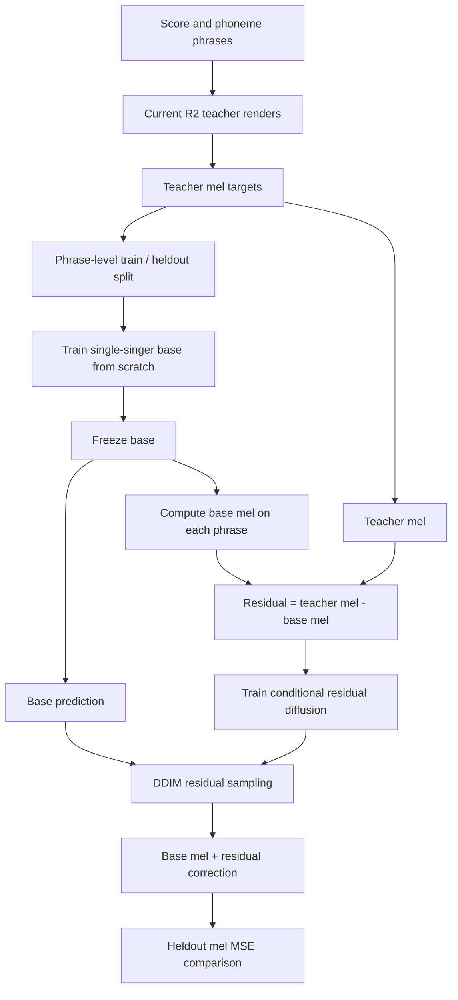

# Single-singer residual diffusion POC

This POC starts from a newly trained single-singer base. It does not reuse the
old base because its R2 teacher input path had failed. The regenerated current
R2 teacher set contains 2,827 phrases; all 2,827 rendered successfully.

## Run configuration

- Data: 204,917 frame samples from 2,827 R2-rendered phrases; 2,544 train and
  283 heldout phrases (18,745 heldout frames).
- Base: trained from random initialization for 100 epochs; 1,024 batch size.
- Diffusion: frozen base, 2,048 hidden units, two residual blocks, cosine
  64-step noise schedule, trained for 100 epochs with 512 batch size.
- MoE comparison: same base checkpoint and phrase split; general expert loaded
  from that checkpoint, five group experts trained for 380 epochs each across
  two runs. Combined expert training time was close to the diffusion run.
- Backend: WGPU on the machine's RTX 5060 Ti.

## Heldout results

Mel MSE is averaged over 128 bins and 18,745 heldout frames; lower is better.

| Model | Heldout mel MSE | Training time | Checkpoint bytes |
| --- | ---: | ---: | ---: |
| Frozen base | 3.365835 | Base training: 100 epochs | 8,144,024 |
| Base + diffusion (100 epochs) | 3.894680 | Diffusion: 350.636 s | 46,336,430 total |
| Base + MoE correction (380 expert epochs) | 3.327334 | MoE correction: 318 s | 48,864,144 total |

Diffusion's heldout sampler clips predicted residuals to `[-1, 1]` to prevent
unstable high-noise estimates. Wider bounds of `[-2, 2]`, `[-4, 4]`, and
`[-8, 8]` scored 4.019250, 4.722221, and 8.502433 respectively. None beat the
base. The MoE improved over the base by about 1.1%; the diffusion POC did not
improve this metric. The MoE package is about 5.5% larger, while the diffusion
package used about 10% more training time.

This is an acoustic-mel comparison only. It does not yet measure listening
quality after vocoding or integrate the diffusion sampler into the playback
engine. The MoE comparison loaded the already-trained base as its general
expert, so its reported correction time excludes the shared base training.

## Reproduction artifacts

Run outputs and checkpoints are in `test/poc/diffusion-r2fixed/`. The model
changes are in `native/crates/moe-train/src/diffusion.rs` and its CLI wiring in
`native/crates/moe-train/src/main.rs`.

## Fresh-base full-pipeline run (2026-09-26)

The engine was added to `synth-cli` as `--engine diffusion`, with explicit
base, denoiser, vocoder, and DDIM-step options. It loads the frozen base and
denoiser from separate checkpoints, samples a residual, adds it to the base
mel, and runs the same pc-nsf-hifigan ONNX vocoder used by R2.

This run trained a new base from random initialization (not from either
previous checkpoint) for 100 epochs, then trained a new denoiser for 100
epochs. A new MoE correction was also trained on that same base for 380
epochs per group. All three use the previously verified current-R2 teacher
set and the same 2,827-phrase split.

| Model | Heldout mel MSE | Training time | Total checkpoint bytes |
| --- | ---: | ---: | ---: |
| Fresh base | 3.550461 | 93 s | 8,144,024 |
| Fresh base + diffusion | 4.212864 | 358 s | 46,336,430 |
| Fresh base + MoE correction | 3.525409 | 320 s | 48,864,144 |

The full render path completed for the same one-note USTX through R2, base-only,
MoE, and diffusion engines. All emitted 44.1 kHz mono WAVs without clipping.
The project audio metrics were:

| Render | Duration | RMS | Onset | Silence | Peak |
| --- | ---: | ---: | ---: | ---: | ---: |
| R2 reference | 1,513 ms | -9.2 dB | 50 ms | 1.3% | 0.789 |
| Fresh base | 1,501 ms | -9.8 dB | 350 ms | 2.0% | 0.889 |
| Fresh base + MoE | 1,501 ms | -10.4 dB | 350 ms | 2.0% | 0.870 |
| Fresh base + diffusion | 1,501 ms | -9.4 dB | 300 ms | 2.0% | 0.934 |

This confirms that the selectable diffusion engine loads both checkpoints and
reaches the vocoder. It does not establish listening-quality parity: the
single-note onset is late in all student renders, though diffusion reduces
that delay by 50 ms in this example. Heldout mel MSE also still favors MoE.
The diffusion training command wrote the checkpoint and 100-epoch report, then
the WGPU process emitted a teardown segmentation fault; loading that saved
checkpoint and rendering through the engine succeeded.

Reproduction checkpoints, logs, and WAVs for this run are in
`test/poc/diffusion-full-20260926/`.

## Larger-capacity run: compare complete model footprints

The follow-up run uses a new 15.7M-parameter base (hidden 3584, depth 1) and a
5.0M-parameter residual denoiser (hidden 1440, depth 2). The MoE uses that same
base as its general expert and adds five independently routed group experts.
Since the two correction designs allocate capacity differently, compare their
complete deployable checkpoint sets rather than trying to match the base and
correction components one-to-one.

| Deployable set | Heldout mel MSE | Correction training time | Checkpoint footprint |
| --- | ---: | ---: | ---: |
| Base only | 3.707809 | shared base training: about 17m 34s | 59.7 MiB |
| Base + diffusion | 4.305851 (64-step eval) | 276.5 s | 78.7 MiB total |
| Base + MoE, all five experts packaged | 3.603720 | about 289 s | 98.5 MiB total |

For MoE, the general checkpoint is 59.7 MiB and each of its five routed experts
is 7.8 MiB. The complete install is therefore larger than the diffusion
package. Inference routes each phoneme group to its expert, though the current
engine loads all experts into memory. In this run the MoE package is about 25%
larger than diffusion;
the heldout mel score favors MoE, while the diffusion correction did not improve
over the base. These are early acoustic metrics, not a listening-quality result.

The same one-note USTX renders through both complete engines. Both student
outputs have a late 400 ms onset versus 50 ms in the R2 reference, so the
current result does not support choosing either model on perceived quality.
Artifacts for this run are in `test/poc/diffusion-large-20260926/`.
