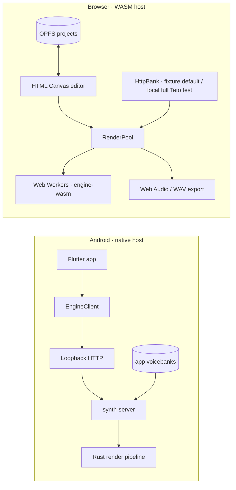

# WASM Migration — สถานะการย้ายไป web

> อัปเดต: 2026-09-23
> ต่อจาก: `docs/planning/web-static-feasibility.md` (feasibility study 2026-08-10)

---

## คำตอบสั้น

**engine ย้ายได้แล้ว** — ทั้ง stack compile เป็น `wasm32-unknown-unknown`
และ render ผลตรงกับ native **ทุก bit** (`max|diff| = 0.000e0`)

**UI เริ่มย้ายแล้ว:** browser editor รองรับแก้โน้ต, undo/redo, render/play,
project browser, OPFS autosave และ import/export `.ustx`; render ผ่าน RenderPool
(Web Worker + per-chunk sample loading + chunk cache, progress/cancel และ epoch
guard กันผลเก่ามาทับ). ยังไม่ใช่ product flow เต็มตัว: voicebank manager/OPFS
import, multi-track mixer, expression lanes และ PWA ยังเหลือ. Neural engines
(ort/burn) ยัง native-first; R2/WebGPU ใน browser เป็น experimental path.

---

## เทียบกับ feasibility doc

| เสา | เอกสารเดิมประเมิน | สถานะจริง |
|---|---|---|
| worldline C++ → wasm | ⚠️ "จุดเสี่ยงหลัก ต้อง Emscripten" | ✅ **ไม่ต้อง Emscripten แล้ว** — port เป็น pure Rust เสร็จ (`worldline-rs`) |
| F0 fallback (libpyin) | (ไม่ได้ประเมิน) | ✅ port libpyin + libgvps เสร็จ — ตรงกับ `.so` 100% |
| Rust engine → wasm | ✅ | ✅ ทำแล้ว (`engine-wasm`) |
| Local storage (OPFS) | ✅ | 🟡 Project browser/autosave/import-export ใช้ OPFS แล้ว; voicebank editor flow ยังใช้ HTTP (`fixture` เป็นค่าเริ่มต้น, `?voicebank=full` สำหรับ local Teto test) และยังไม่มี OPFS import UI |
| Plugin .so / dlopen | ❌ ต้อง redesign | ✅ feature-gate แล้ว (`ffi` feature) |
| burn บน WASM | ✅ | 🟡 **spike 2026-09-23: compile ผ่าน** (burn 0.21 `ndarray` + `getrandom` `wasm_js` + `--cfg getrandom_backend="wasm_js"`) — ยังไม่มี engine/โมเดลที่รันจริงบน wasm |
| ONNX → burn | ✅ | 🟡 **spike 2026-09-23: `ort` แบบ `default-features = false` compile ผ่าน** แต่ต้องพก onnxruntime-web (JS) ตอนรัน + โมเดล DiffSinger 271 MB ไม่คุ้มโหลดเข้าบราวเซอร์ |
| train บน WebGPU | 🔶 ต้อง spike | ⬜ ยังไม่ทำ |
| Browser editor | (ยังไม่ได้ประเมิน) | 🟡 Vertical slice + **RenderPool ใน editor** ผ่าน headless test; project persistence เสร็จ, voicebank flow/PWA/feature breadth ยังเหลือ |
| Static hosting | ✅ | ⬜ ยังไม่มี PWA/deploy config |

**การค้นพบสำคัญ:** feasibility doc คิดว่า worldline ต้อง compile C++ ด้วย
Emscripten — แต่จริงๆ **port เป็น Rust ตรงกว่าและได้ผลตรงกว่า** เพราะตอนนี้
Rust engine ให้ผลเหมือน `.so` ระดับ sample อยู่แล้ว ไม่ต้องพึ่ง Emscripten
runtime เลย

---

## สถาปัตยกรรม



Native and browser hosts share Rust project/render logic where the target
supports it. Browser R1 runs in-process through WASM workers; it does not call
the Android `synth-server`.

crate ที่เพิ่ม:

| crate | หน้าที่ |
|---|---|
| `world-rs` | WORLD DSP kernel (มีอยู่แล้ว) |
| `worldline-rs` | PhraseSynth + **Classic resampler** (port ใหม่) |
| `engine-wasm` | wasm-bindgen entry point (ใหม่) |
| `tools/world-oracle` | เครื่องมือเทียบ stage-by-stage (ใหม่) |

---

## หลักฐานความถูกต้อง

| test | ผล |
|---|---|
| `engine-wasm` in-memory vs disk render | 132066 samples, **max\|diff\| = 0.000e0** |
| `world-oracle phrase` demo-song | 110081 = 110081, rms diff 9.0e-6 |
| `world-oracle phrase` scale-demo | 639489 = 639489, rms diff 3.5e-5 |
| `world-oracle classic` | worst max\|diff\| 9.11e-5 |
| `world-oracle pyin` | voicing agreement 100%, mean/max cents 0.00 |
| headless Chromium (`web/run-smoke.sh`) | 132066 samples, peak 0.9884 = native |
| `rust_kernel_matches_so_*` | PASS |
| `rust_classic_resampler_matches_so` | PASS |
| `cargo test -p engine-wasm` (2026-09-12) | **11/11 PASS** — memory render + project commands |
| `web/run-pool.sh` (2026-09-12) | pool/sequential + incremental **bit-identical**, unchanged render 0 chunks |
| `web/editor-test.html` (2026-09-12) | **PASS** — boot/canvas/edit/undo/draw/marquee/render/zoom |
| `web/run-editor.sh` (2026-09-23) | **PASS** — pool wired: แก้ 1 note → **1/6 chunk**, ไม่แก้อะไร → **0/6 chunk (2 ms)**, cancel ทิ้งผลถูกต้อง |
| **ไฟล์จริง**: `web/run-real.sh` vs `synth-cli --engine r1-rs` (2026-09-23) | เพลงจริง `sakura-test.ustx` + bank จริง 558 wav/93 MB → **302162 bytes เท่ากัน และ `cmp` bit-identical** (peak 0.6250, fnv ff7020b8) |
| pool บน bank จริง (2026-09-23) | โหลดแค่ **8 จาก 558 wav** (per-chunk loading), pool vs sequential `max\|diff\| = 0.0e+0` |
| `web/run-editor.sh` step 12 — OPFS (2026-09-23) | **PASS** — `save → list → open` round-trip ตรง, autosave เขียนจริง, delete ทำงาน |
| `domain::round_trip::project_yaml_is_byte_stable_across_reload` (2026-09-23) | **PASS** — ยามกัน YAML ไม่นิ่ง (ดูหมายเหตุท้ายตาราง) |

**บั๊กที่เจอตอนทำ persistence (แก้แล้ว 2026-09-23):** `UProject.expressions` เป็น
`HashMap` และ serde เขียนตามลำดับ hash → `project_yaml()` ของเอกสารเดียวกันให้
bytes ไม่เหมือนกันในสองครั้งที่โหลด (และต่างกันข้าม process) ทำให้ autosave
เทียบข้อความไม่ได้และไฟล์ถูกเขียนใหม่ทั้งที่ไม่มีใครแก้. แก้ด้วย
`serialize_with = "sorted_expressions"` (เรียงตาม abbr) + regression test —
การ render ไม่กระทบเพราะ `phrase::builder` sort descriptor อยู่แล้ว และไฟล์จริง
ยัง bit-identical กับ native.

ขนาด wasm (release): **1.43 MB** (508 KB gzip)

---

## งานที่เหลือ (เรียงตามความสำคัญ)

1. ~~**ต่อ editor เข้ากับ RenderPool**~~ — **เสร็จ 2026-09-23**: `web/app/editor.js`
   สร้าง pool ตอน boot, `setProject` + `render({signal, onProgress})` ทุกครั้งที่แก้,
   epoch guard + `cancelRender()` (ปุ่ม Stop), chunk overlay จาก cache จริง;
   ถอยไป main thread อัตโนมัติถ้า Worker ใช้ไม่ได้ — เทสต์: `web/run-editor.sh`
2. **Project persistence** — **เสร็จ 2026-09-23**:
   `web/app/project-store.js` เก็บ `.ustx` ใน OPFS (`projects/<name>.ustx`),
   editor มี project browser (list/open/new/save as/delete), autosave 1500 ms,
   export/import `.ustx` และ `navigator.storage.persist()`. **เหลือ voicebank**:
   import/เลือก bank ผ่าน UI และเชื่อมกับ `OpfsBank`; ตอนนี้ editor ใช้ `HttpBank`
   (fixture เป็นค่าเริ่มต้น, `?voicebank=full` ใช้ทดสอบ local Teto bank)
3. **UI production breadth** — multi-track mix, expression lanes, phoneme labels
   authoritative, voicebank flow และ tablet/pen hardware QA
4. **Neural engines** — native R2 / DiffSinger ใช้งานได้; R2/WebGPU บน browser ยังเป็น
   experimental path. **ทิศทางที่ตกลงสำหรับ product: รันบน native server** (ผ่าน render
   backend ข้อ 3) ไม่ต้องโหลดโมเดลเข้าบราวเซอร์; ถ้าจะลอง neural บน wasm จริงให้เริ่มจาก
   **moe/burn** (8–40 MB) เพราะ ort/ONNX ต้องพก runtime + โมเดล 56–271 MB
   (ผล spike: ทั้ง `ort` และ `burn` compile ผ่านบน wasm32 — ดู
   [web-render-backend.md](web-render-backend.md) §1.3)
   (และมีแผนแยก **render backend** ให้เว็บต่อ `synth-server` ได้ด้วย —
   ดู [web-render-backend.md](web-render-backend.md) ซึ่งจะทำให้ neural engine
   ใช้ผ่าน server ได้ก่อนโดยไม่ต้อง port ลง wasm)
5. **Static hosting + service worker** — PWA/offline/versioning และ deploy จริง

---

## วิธีใช้

```sh
# engine wasm (release)
cd native
cargo build --release --target wasm32-unknown-unknown -p engine-wasm
wasm-bindgen --target web --out-dir web-pkg \
  target/wasm32-unknown-unknown/release/engine_wasm.wasm

# ทดสอบ parity กับ native (ไม่ต้อง browser)
cargo test -p engine-wasm
cargo test -p synth-cli --test render_real -- --ignored   # ต้องมี .so
```
